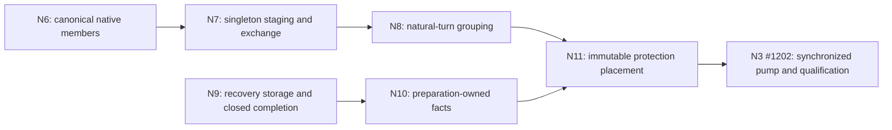

# Final pipeline slice seam audit for issue #1202

The complete candidate now has measured-path feasibility, and the replacement can be packaged as seven bounded ownership slices. The existing A/B/C outline alone is incomplete: it omits the recovery representation, preparation-owned facts, and the full protection-placement ownership change. Preserve N3 #1202 for the synchronized endpoint owner/pump and integrated qualification; create new identities for N6–N11, leave withdrawn N5 unused, and retain completed N0 #1199, N1 #1200, N2 #1201 and N4 #1213. This memo assigns no issue numbers to the new slices and performs no tracker action.

Source comparison is pinned to production baseline `b39389b152a728232b7ec68ed1060c213c6649a8` and complete diagnostic candidate `78fac7ec3cd60d0dfc03c14dded71ed66c5bf0b2`. The reviewed proposal is `58aa4d72058ec493d8770a9546d8e007ef044672:docs/audits/2026-11-05-native-pipeline-redesign.md`. Only immutable Git reads and local evidence reads were used; no source edits, builds, workloads, network or issue/OmniFocus mutations occurred. Candidate line anchors below are for `78fac7ec`; explicitly labeled baseline anchors are for `b39389b`.

The final unchanged-source `protection-placement-v1-isolated1` pair is clean and passes the existing ordinary STREAM/GSO-on diagnostic: goodput ratio 1.0488583011843862 and CPU/useful-byte ratio 1.0689904803066572. Independent verification reports 3,219 checks and no failures. The analysis explicitly retains `product_viability_eligible=false`: mixed traffic, multipath, hostile resources, the full supported qualification set and release qualification are not established. The competing jobs ended before the guarded preflight; no competing cpuset was written, and the unchanged runner ran directly on the naturally vacated venue. This result permits concrete implementation planning, not merging the diagnostic tree or calling its intermediate slices tested.

## Required graph and identity disposition

N6 and N9 are the new implementation frontier after plan publication and ordinary workflow preflight. The graph retains all completed predecessor contracts. N11→N3 #1202 is an explicit integration/evidence edge: mutex ownership does not cryptographically require deferred protection, but N3 #1202 must qualify the composed repair that demonstrated feasibility. N9→N10 is a concrete registration-owner dependency, and N8+N10→N11 are concrete construction-ticket/facts dependencies. There is no claim that each slice must independently meet the whole-pipeline performance target, and no new per-slice benchmark campaign is implied.

Preserving #1202 is appropriate because it still closes the same unresolved synchronized-endpoint efficiency outcome. Do not repurpose it into a parent covering every new owner or treat its old unmerged synchronization source as a merged predecessor. The new slices deserve separate identities because each has its own active production behavior and terminating semantic evidence. Four completed plus seven remaining gives eleven N-track slices; other program counts and downstream references must be reconciled by the parent, not inferred from prototype commit counts.

## Source basis and owner census

The current default branch is the pinned baseline above. The following bounded symbol census is the governing map; future implementers read relevant symbols and direct dependencies, not entire historical design versions.

## Concrete slice boundaries

| Slice | Active production behavior and authoritative owner | Bounded implementation surface | Independent-green boundary and distinguishing semantic classes |
| --- | --- | --- | --- |
| N6 | One typed native request and one per-member result representation under the existing actor owner. All current production constructors produce that representation; they may remain singleton callers. | `native_endpoint.go`: request/member/result storage, `checkedSize`, commit/publication/disposal, member writer/fallback and final-return fact; `native_ordinary.go`: ordinary, close, path-close and probe constructors plus result adaptation; `native_response.go`: both public/stateless constructors. Focused native geometry/member/lifetime tests. | All endpoint classes remain executable with the old command/ack owner. Cover mixed member GSO/ECN/OOB, coalesced packets versus datagrams, middle error/unattempted suffix, setup/reset deadline errors, public borrowed bytes and release-before-credit. No dormant second admitted representation. No grouping, crypto or mutex prerequisite. |
| N7 | Connection-owned single-member Building/Staged lifecycle, exact-size transfer and bounded endpoint exchange. Ordinary production on supported routes uses it with one member; complete-input probes retain release-on-refusal/validation-budget retry, while close/path-close retains its deposited endpoint obligation. Their barriers, revoke/drain and exact results are covered without ordinary staging. | `native_ordinary.go`: reserve/readiness, record lifecycle, offer/exchange, consume/deferred FIFO, reset/rebind/path replacement/drain/close; a focused local-request module if extracted; `packet_emission_local.go`; `connection.go` run-loop progress and staged timer only; endpoint exchange transaction over the actor owner. Read existing route/credit interfaces. | Removes guessed endpoint reservation without introducing grouped production. Close the four-slot states, per-endpoint spare slot, exact refused-head demand, original deadline, hard-blocked expiry, A-blocked/B-progress, old-generation settlement and callback-safe detached result FIFO. Singleton staging is an active independently useful implementation, not another representation. |
| N8 | Accumulate already-produced members within the natural emission turn in the same canonical N7 record and transfer once. | Local builder/member sidecar and seal/offer/drop/recycle; `native_ordinary.go` registration/member mapping and ordered consume; `packet_emission.go` and `packet_emission_bbr.go` only natural-turn/route/control barriers and existing batch metadata. Read N7 event/expiry and N6 native contracts unchanged. | Extends an already complete singleton lifecycle, rather than introducing lifecycle plus grouping at once. Cover zero-member release, multi-member success, partial-buffer construction failure, every natural seal reason, route/tuple/epoch/class barriers, exact token-to-member/datagram mapping, refused grouped head and successor/FIFO. Preserve all existing byte/member/path/record bounds; no waiting for fill or future data. |
| N9 | Recovery owns canonical never-reused completion identity, exact history membership/rank/PTO projections, ECN storage and the strictly callback-free accepted completion interval. | `internal/ackhandler/{local_completion.go,local_packet_ranks.go,sent_packet_history.go,local_ecn.go,local_ecn_records.go,lost_packet_tracker.go,sent_packet_handler.go,sent_path.go}` and a small accepted-span implementation; one bounded packet-loop adapter in `native_ordinary.go`. Do not include preparation/pool changes from `packet.go` here. | Active under the baseline singleton request domain, independently of N6/N8. Preserve scalar API and full fallback. Cover old/foreign/duplicate identities, Retry/key/path/close retirement, holes/skips/probes, exact pending/live counts, old iterators, early ACK and reentrant callbacks; closed-span exclusions, same per-packet timestamps/canonical/ECN order, fresh final timer and scalar equivalence. No manual identity reuse, tuple lookup rewrite, packet cache or history-pointer substitution. |
| N10 | Preparation owns the final recovery packet facts before registration; recovery adopts only after validation, before callbacks. Native emission avoids the large aggregate metadata forwards. | `internal/ackhandler/packet_preparation.go`, `packet.go`, registration adoption and shared sent-packet accounting/publication; `packet_packer.go` short-header preparation/serialization; `packet_emission_prepared.go` and its three callers; prepared logging/activity hooks in `connection_logging.go`, `connection.go`, and policy adapters. | Consumes N9's validated registration owner, but works with a singleton native sender and synchronous sealer. Native preparation path is used immediately. Cover seal/refusal/PN failure, cap-one backing growth/discard, ACK pooling and callback reentry, fresh handler/local receiver resolution, late ACK-target and DATAGRAM scans, logging/activity order. Preserve generic/value path and inspect its shared helper/compiler costs too. No deferred protection yet. |
| N11 | Connection synchronously reserves key/PN/encryption policy; an independently owned per-buffer plan carries immutable pure-protection inputs to the existing isolated writer. | `internal/handshake/{packet_protection.go,cipher_suite.go,header_protector.go,updatable_aead.go}`; native protection plan/construction and platform stub; the N10 pack/seal reservation seam; N8 handoff ticket/drop lifecycle; N6 admission/member transform/publication release. No endpoint synchronization rewrite. | Complete vertical feature after N8+N10, running with the existing actor-fed writer. Cover all three supported ciphers/versions, unsupported/FIPS/wrapper/path fallback, policy error/PN commitment, old-key concurrent sync/deferred use, ticket replacement and prefix materialization, capacity refusal, pre/post-transform cancellation, retries and actual-return borrow. No placeholder plan API without an active end-to-end caller. |
| N3 #1202 | One synchronized endpoint authority, writer-only fair claim, independent progress/timer/join, and the integrated final repair. | `native_endpoint.go`: constructor/`do`, progress/settlement, claim/park, timer wake coverage, queue-summary/demand mutation maintenance, arbitration and terminal join; narrow caller adaptation only. Consume N6–N11 contracts; do not absorb their implementation. | Replace the actor protocol as a whole, with no overlapping mutation owners. Cover all endpoint classes, parked enqueue, contended/noncontended return reconciliation, earlier deadline/retry, timely fact versus absent overdue, revoke/seal, grant/turn fairness, FIFO, blocked writer responsiveness and unlocked join. Perform the existing integrated semantic/race/native and GSO-on/off qualification obligations; downstream R17 #1037/R18 #1038 retain their own purpose and inventory. |

This is an ownership graph, not seven independent performance hypotheses. No extracted intermediate tree was built during this audit. “Independent green” above means a concrete executable behavior and closed authority boundary that can be implemented and certified independently; the complete candidate's test pass is not a test receipt for any of these future intermediate commits.

## Why N9 and N10 do not require grouped production

Baseline `native_ordinary.go:730–791` already has a single buffer's exact accepted/uncertain/unsubmitted result, `record.datagrams`, ordered `record.packets`, terminal-receipt publication before the packet loop, and path/error policy after it. N9 can attempt its closed accepted span at that existing packet loop only when the full acceptance/count/MTU predicates permit it. An ordinary GSO buffer is already a multi-packet member. Coalesced handshake packets, partial results, MTU hooks, rich feedback, qlog, early ACK, pending ECN feedback and invalid tokens decline to the unchanged scalar order. N6's typed request and N8's multi-buffer grouping add no authority needed for that interval.

N9 should retain canonical registration storage and all mutation-source accounting together. The scalar path remains the reference behavior. The final candidate's `local_completion_span_diagnostic.go:69–135` is a useful proof and algorithm, but its atomic `LocalCompletionTiming` descriptor is measurement plumbing to remove from production, not a new recovery-policy capability. The index-saving accepted ECN operation is valid only inside that proved observer-free interval; the generic scalar path must retain its fresh search after callbacks.

N10's actual dependency is the canonical validation/registration owner: `validateLocalPacket`, `newLocalRegistration`, `finishLocalRegistration` and the existing ordered sent-packet side effects (`local_completion.go:183–268`). N10 adds an adopted packet to that owner; it does not duplicate registration policy or change packet identity. It owns the `PacketPreparation`/`PreparedPacketView` lifetime, cap-one stream storage cleanup, and shared accounting/publication extraction. The preparation handle is consumed before callbacks; the post-registration receipt is only the original control-frame slice header plus size, preserving both later DATAGRAM observations. Do not pass a stack preparation handle through policy interfaces or inspect adopted packet/view fields after callbacks may pool the packet (`packet_emission_prepared.go:30–74`). The default synchronous/value path remains independently exercised, with shared helper traffic disclosed.

## Required contract corrections before dispatch

**Canonical authority, not copied prototype forms.** Candidate `native_endpoint.go:134–205` retains flat buffers, owned member rows, raw datagrams, aggregate results and legacy result slices. `native_ordinary.go:254–255` selects grouping only for confirmed ordinary path zero without path credit; the legacy Send/close/probe paths remain active. These are deliberate diagnostic compatibility forms. N6 must normalize all admitted requests at the boundary and remove duplicate admitted geometry/results. A raw endpoint datagram may remain a typed payload/lifetime alternative; it must not be forced into packet-buffer release semantics merely to make types look uniform. A consuming singleton adapter is acceptable; retaining two live admitted authorities until N7 is not.

**Ordinary all-route staging and distinct probe/close lifecycles must be designed, not enabled by deleting one branch.** `diagReserve` refuses construction when any staged group exists and its prototype records use ordinary path-zero identity. That is not the required A-blocked/B-progress algorithm. N7 must have the per-participant/lane oldest-head rule, spare-record accounting and exact credit ownership before N8 extends a builder. `diagOffer` can detach terminal facts even when admission fails, so deferred FIFO and connection checkpoint consumption belong with exchange. Existing reset/rebind/move-zero/drain/close paths have different generation effects; one global cancel helper is not a substitute for their census. Preserve the explicit change from endpoint-admission-before-DATAGRAM-extraction to local ownership/frozen route before endpoint transfer, with the existing payload bounds and no double charging.

**TryLock changes notification implementation, not independent progress.** The current document's unconditional “publish ... and notify” sentence must become the selected contract: store the immutable final-return fact first; immediately reconcile under the canonical mutex if TryLock succeeds; otherwise notify before waiting on Lock. Initial and post-park entry still use ordinary Lock. Preserve terminal and earlier-deadline notification, the runner's armed-deadline snapshot, no post-snapshot wake drain, and no token/payload access after Store (`native_endpoint.go:1566–1651`, `1279–1361`). Queue deadline summaries are valid only under transition-owned invalidation; external authorization remains observable rather than cached away. No native call, policy callback, sink, join or grant-return callback may hold control.

**Committed protection input is an explicit internal contract amendment.** N11 does not move the mutable sealer or key policy onto the writer. Exact constructor-proven capability, synchronous key-phase selection, encryption-limit errors, first-PN/key counters and original PN commitment remain on the connection (`packet_protection.go:57–138`, `packet_packer.go:610–654`). The writer receives immutable key/PN plus validated fixed geometry and writer-local scratch. Existing synchronous traffic may use the same immutable primitive concurrently; arbitrary AEAD implementations or wrapper-inherited capability are not authorized. Unsupported observers receive materialized ciphertext first. The ticket must survive callbacks independently of the sidecar and materialize the original plan before fresh synchronous handoff on mismatch. Consume it before Send can reenter. Capacity refusal retains producer ownership; successful admission transfers once; queued disposal or actual-return publication releases all remaining key/buffer references before credit wakes. Do not hide a new key retention or packet layout cost behind the word “offload.”

One check precedes each bounded member transform, and all original pre-native/retry checks remain. There is no per-instruction crypto cancellation guarantee. The original absolute deadline already includes preparation; moving protection into claimed writer service changes scheduling within that same deadline, not B or its tolerance. Preserve request-level deadline-control failure separately from each member's timestamp/outcome. Accepted spans retain per-packet canonical/ECN updates and a fresh final timer; the prohibition on generic group-end loss/ECN and lazy alarm invalidation remains intact.

## Context bounds and evidence extraction

Use the existing fresh-context discipline, including the accepted 24k dispatch-input bound for N3 #1202; do not fill dispatches with the complete diagnostic history. Each new slice needs only its row's write surface, named predecessor interfaces, the relevant contract rows and distinguishing tests. Root-level files such as `connection.go` and `packet_packer.go` must be supplied as exact relevant symbols plus direct dependencies, not as the whole connection implementation. N6 closes all native constructors; N7 closes the record lifecycle; N8 changes only builder aggregation; N9 stays in recovery plus its small existing completion adapter; N10 covers only construction/registration facts; N11 covers the complete protection transfer; N3 #1202 covers only the endpoint synchronization protocol and integrated evidence. These are the context stops, not arbitrary line-count targets. A dispatch manifest must record its actual token count; this audit did not tokenize future implementation patches and does not certify their exact size in advance.

The baseline-to-candidate diff contains 32 non-test Go files, but filenames are not sufficient to separate production from measurement. `native_group_diagnostic.go` and the accepted-span file contain selected runtime logic to reimplement under the authoritative owners. Conversely, remove `pipeline_diagnostic.go`, pipeline counters/timers, temporary environment/probe controls and driver changes from production. Retain useful characterization cases as focused tests where they enforce a selected contract; do not ship the diagnostic source archive or all historical probes as a maintained harness. The withdrawn packet cache, tuple identities and canonical-history pointer rewrite remain excluded.

New tests should distinguish the finite semantic classes in the table, reusing the existing actual-return, early-ACK, FIFO, route/control, capacity, cipher and callback cases. Correctness/race/compiler receipts of `78fac7ec` are evidence for that prototype only. Each actual slice and final integration still require their exact-head checks. The clean single-cell comparison does not replace GSO-off, mixed/control/native stall, supported-toolchain or R17 #1037/R18 #1038 evidence, and it does not authorize a new benchmark campaign from this memo.

Recommendation: publish the seven-slice contract graph with N6 and N9 as the new frontier, preserve N3 #1202 as the final synchronized integration/qualification slice, and make the four contract corrections above normative. The measured complete candidate is implementation evidence and a feasibility witness; it is neither the production baseline nor a set of already-green intermediate PRs.

## Root disposition and legacy rebaseline

The root accepts the seven-owner graph, retains N3 #1202 and adds N6–N11 without reusing withdrawn N5. Completed N0 #1199, N1 #1200, N2 #1201 and N4 #1213 keep their shipped behavior and prior receipts. New intermediate commits have not been built or qualified; their structural boundaries must be independently implemented and certified. The complete diagnostic remains unpushed source material.

| Prior obligation or artifact | Disposition | Current owner / reason |
| --- | --- | --- |
| Per-buffer endpoint reservation before destructive construction | Replace with bounded local ownership before construction and exact endpoint transfer | N7 owns ordinary all-route staging/demand/expiry and preserves complete-input probe/close variants; N8 adds grouping afterward. |
| Flat buffers/global GSO and one aggregate result beside native member rows | Remove duplicate admitted authority | N6 normalizes every constructor and exact result, including distinct raw-datagram borrow semantics. |
| Writer never enters endpoint control | Replace with bounded writer-only claim/reconciliation under the single synchronized owner | N3 preserves independent expiry, actual-return publication and no lock-held native/protection/callback work. |
| Admitted bytes always already ciphertext | Amend only for proven ordinary immutable protection capability | N11 preserves synchronous policy and unsupported fallbacks, with two explicit plan ownership transfers. |
| Proposed standalone N5 PTO cache and withdrawn packet cache | Keep withdrawn; no issue or dependency | Exact mutation-owned history projections belong with N9; lazy policy/alarm caching and unsafe reused identities remain excluded. |
| Long experiment chronology in the normative plan | Move behind linked audits | Current plan contains accepted outcomes/owners/evidence/stops; original receipts retain exact sources and failed evidence. |
| Prototype instrumentation, analyzers and affinity controller | Verification aids/frozen evidence; not maintained product blockers | Remove temporary counters/hooks/env controls from runtime slices; no recursive harness proof or live restoration claim. |
| Old deterministic scenario-count forecasts | Replace with the current finite semantic-class evidence plan, preserving admitted behavior | The owner split changes test seams; reuse inherited cases and add no arbitrary replacement cap or recursive proof obligation. |
| Existing review/native/ordinary and downstream qualification | Preserve scope and purpose | Local slice evidence, N3 exact combined evidence and R17 #1037/R18 #1038 qualification remain distinct; no extra per-slice benchmark gate. |

The one clean ordinary pair and source/semantic/cost receipts supply feasibility. The original and replacement contaminated pairs remain ineligible. The final comparison was independently replayed with 3,219 checks and no failures; no competing-workload affinity/cpuset was changed. Diagnostic cumulative accounting is 238 invocations / at least 5248.659792051 measured host-seconds, with preparation/quiet/controller setup separately preserved. This audit does not turn source-level mechanism evidence into full product qualification.

## Publication review

Independent source review by the endpoint-design auditor and independent policy/graph review by the evidence verifier found no remaining blocking gap after the accepted corrections below. Root independently accepted these as in-contract owner/wording corrections and applied them before publication. No further runtime measurement, review expansion or new gating service was required.

- Preserve N4 accounting/lifetime invariants while allowing N9’s canonical identity/count representation to replace the old map.
- Keep N10’s fresh callback-point receiver reads separate from N11’s protection/group ticket.
- Preserve probe release-on-refusal/validation-budget retry and deposited close/path-close obligations as canonical complete-input variants; do not force them through ordinary staging.
- State TryLock failure as notification before waiting on Lock, with no token/payload use after publication and no post-snapshot wake drain.
- Make the accepted-span no-observer preflight and fresh final-timer substitution explicit, including mutation-free decline and scalar fallback.
- Use the shared finite evidence boundary: positive per behavior, negative per materially different failure mode and supported owner, not a compulsory negative for each positive-only class.

The clean evidence receipt separately passed independent numeric/source/permission review, with a historical-gap tense correction and a clarification that cumulative goroutine roots overlap other attribution views. All earlier contaminated evidence stays ineligible. Review snapshots and source/plan hashes are retained in the existing local diagnostic archive. The repository’s authorized documentation path requires source/contract review, exact-head local link/graph/diff checks and successful applicable hosted checks before merge; it does not add a RAS cycle to this docs-only publication.
